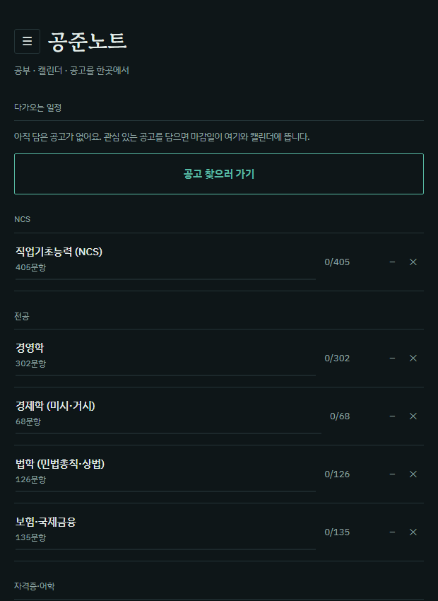
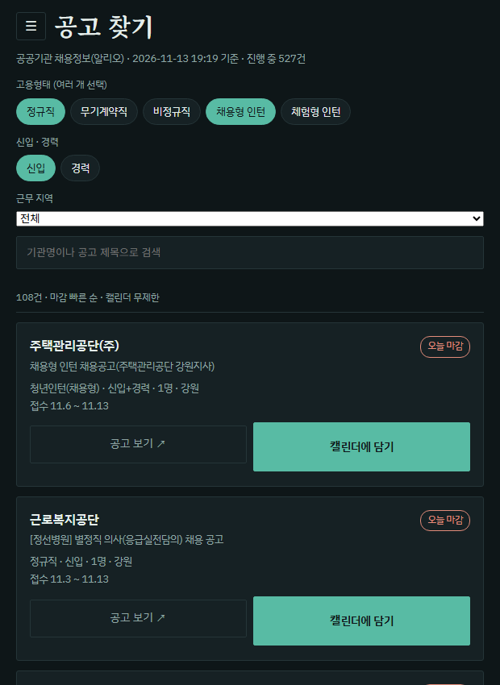
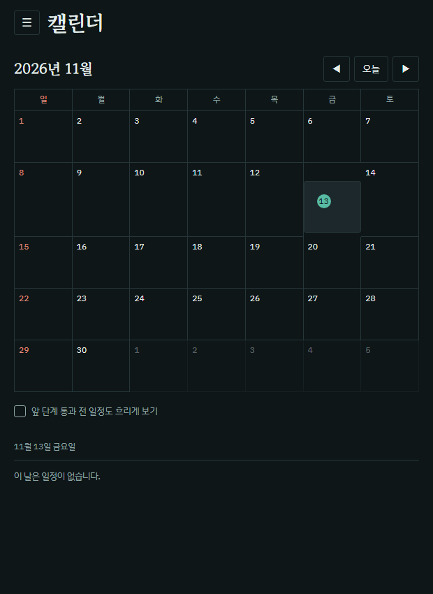

# 공준노트

공기업 시험 공부, 채용 공고, 일정을 한곳에서 보는 웹앱입니다.

**바로 쓰기 → https://idayon.github.io/gongjun-note/**

설치나 가입 없이 브라우저에서 열면 됩니다. 휴대폰에서도 같은 화면으로 씁니다.

| 공부 | 공고 찾기 | 캘린더 |
|---|---|---|
|  |  |  |

## 왜 만들었나

공기업을 준비하면서 불편했던 게 세 가지였습니다.

- 문제집, 정리 노트, 오답이 따로 놀아서 틀린 문제의 개념을 다시 찾는 데 시간이 걸렸습니다.
- 채용 공고를 매일 여러 사이트에서 확인해야 했고, 체험형 인턴이나 대체 인력 공고가 섞여 있어 걸러 내기 번거로웠습니다.
- 지원한 곳의 서류 마감, 필기, 면접 날짜를 따로 적어 두다 보니 놓치는 일이 생겼습니다.

그래서 이 세 가지를 한 화면에서 해결하는 앱을 만들어 직접 쓰고 있습니다.

## 할 수 있는 것

**공부**
- 과목별 개념 정리, 4지선다 문제, 암기 카드
- 문제마다 연결된 정리가 있어서, 틀리면 바로 해당 개념으로 넘어갑니다
- 정답률과 풀이 시간을 기록해 다음에 볼 단원을 추천합니다

**공고 찾기**
- 공공기관 채용 공고를 하루 세 번 자동으로 모읍니다
- 고용형태(정규직, 채용형 인턴 등), 신입·경력, 근무 지역, 검색어로 거릅니다
- 마음에 드는 공고는 캘린더에 담습니다

**캘린더 · 내 공고**
- 담은 공고의 마감일과 전형 일정을 월간 달력으로 봅니다
- 전형 단계별 진행 상태(서류, 필기, 면접)를 기록합니다

**백업**
- 기록은 서버가 아니라 쓰는 사람의 기기(브라우저)에만 저장됩니다
- 파일로 내보내고 다시 불러올 수 있습니다

## 들어 있는 과목

| 구분 | 과목 | 정리 | 문제 | 카드 |
|---|---|---:|---:|---:|
| NCS | 직업기초능력 10개 영역 | 14 | 405 | 59 |
| 전공 | 경영학 | 24 | 302 | 81 |
| 전공 | 경제학 (미시·거시) | 21 | 68 | 62 |
| 전공 | 법학 (민법총칙·상법) | 41 | 126 | 114 |
| 전공 | 보험·국제금융 | 12 | 135 | 35 |
| 자격증 | 정보처리기사 | 11 | 100 | 100 |
| 자격증 | 투자자산운용사 | 16 | 117 | 48 |
| 자격증 | 컴퓨터활용능력 1급 필기 | 24 | 210 | 67 |
| 자격증 | 컴퓨터활용능력 1급 실기 | - | 201 | - |
| 어학 | OPIc | 5 | - | 15 |
| 자격증 | 한국사 (한능검 심화) | 63 | 239 | 135 |

문제 1,903개, 정리 231편입니다. 문제와 정리는 직접 만든 것이고, 시중 문제집이나 기출 문제를 옮기지 않았습니다.

## 어떻게 돌아가나

```
공공데이터포털 API ──(GitHub Actions, 하루 3번)──▶ feed.json ──▶ 공고 찾기 화면
                                                        ▲
잡알리오 공고 페이지 ──(첨부파일 이름 확인)────────────┘

index.html (앱 전체) ──▶ 브라우저 ──▶ 기록은 기기 안(localStorage)에 저장
```

- 서버가 없습니다. 화면은 `index.html` 한 파일이고 GitHub Pages로 올라갑니다.
- 공고는 `scripts/feed.js`가 공공데이터포털의 「공공기관 채용정보 조회서비스」에서 진행 중인 공고를 받아 `feed.json`으로 저장합니다. `.github/workflows/feed.yml`이 매일 06시, 12시, 18시에 실행합니다.
- API가 잠깐 끊기면 간격을 늘려 다시 시도하고, 끝내 못 받으면 기존 목록을 그대로 둡니다. 빈 목록이 올라가는 일을 막기 위해서입니다.

## 폴더

| 경로 | 내용 |
|---|---|
| `index.html` | 앱 전체 (화면, 동작, 내장 과목 데이터) |
| `packs/` | 과목별 원본 데이터 (JSON) |
| `scripts/feed.js` | 공고 수집 스크립트 |
| `.github/workflows/feed.yml` | 공고 수집 일정 |
| `feed.json` | 수집된 공고 (자동 갱신) |

## 과목 데이터 형식

```json
{
  "id": "ncs",
  "name": "직업기초능력 (NCS)",
  "notes":     [{ "sub": "수리능력", "title": "수리능력 핵심", "body": "마크다운" }],
  "questions": [{ "sub": "수리능력", "q": "문제", "o": ["보기1","보기2","보기3","보기4"], "a": 1, "e": "해설", "t": "수리능력 핵심" }],
  "cards":     [{ "sub": "수리능력", "front": "앞면", "back": "뒷면" }]
}
```

`a`는 정답 위치(0부터), `t`는 연결된 정리 제목입니다.

## 만든 방식

무엇을 만들지와 기준은 제가 정하고, 코드는 AI(Claude)와 함께 작성했습니다. 직접 써 보면서 불편한 점을 찾아 고쳐 나가고 있습니다.

## 데이터 출처

채용 공고: 공공데이터포털 「재정경제부_공공기관 채용정보 조회서비스」
